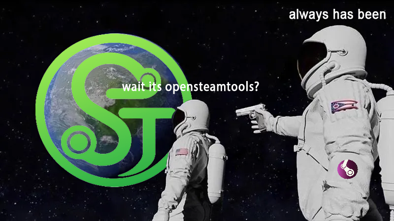

<div align="center">
  

  <h1>AmethystTool - a fork of OpenSteamTools!</h1>

  <p>
    <strong>Open-Source Steam Unlock Tool</strong>
  </p>

  <p>
    
    
    
    <a href="https://github.com/ArthurS357/BetterSteamTools-Amethyst/actions/workflows/linux-logic-tests.yml">
      
    </a>
    <a href="https://deepwiki.com/OpenSteam001/OpenSteamTool">
      
    </a>
  </p>

  <p>
    <a href="README.md">
      
      English
    </a>
    &nbsp;|&nbsp;
    <a href="README_ES.md">
      
      Español
    </a>
    &nbsp;|&nbsp;
    <a href="README_ZH.md">
      
      中文
    </a>
  </p>
</div>

## About this fork (Amethyst)

AmethystTool is a privacy-hardened fork of OpenSteamTools. Behavioural differences from upstream:

- **Self-update is disabled and compiled out.** Upstream downloaded a replacement DLL on startup and overwrote itself in place, verifying integrity only against a hash served by the same channel — so whoever controlled a mirror controlled the code that ran on your machine (a remote-code-execution vector), and the fork stayed tethered to upstream infrastructure. The Amethyst build removes this path entirely; the `[update] enabled` key is still parsed for config compatibility but has no effect. (Rebuild with `OST_ENABLE_AUTOUPDATE` defined to restore the old behaviour.)
- **Telemetry is off by default.** The stats API (`https://stats.opensteamtool.com/{appid}`, which reveals which apps you launch) is opt-in: `[stats] enable_api = false` unless you turn it on.
- **Resilient local cache.** [Pattern lookup](#steam-version-compatibility) reads a local cache under `<Steam>\amethysttool\` first and only consults the steam-monitor trackers on a cache miss (typically after a Steam update) — or, throttled to once a day, when a cached file leaves required hooks unresolved ([self-healing cache](#steam-version-compatibility)).
- **Renamed surface.** The DLL is `AmethystTool.dll` and the config file is `amethysttool.toml`. Settings from a pre-rename `opensteamtool.toml` are migrated automatically on first launch — see [Config migration](#config-migration).

> **Test in an isolated environment before using on your main account.** Injecting into Steam carries account risk that is entirely yours — see [TESTING.md](TESTING.md).

## Feature

### Core Unlocks
- Unlock an unlimited number of unowned games.
- Unlock all DLCs for unowned games.
- Support auto load depot decryption keys from Lua config.
- Support auto manifest download via `wudrm` / `steamrun` / `opensteamtool` upstream APIs (default is `wudrm` as of v1.3.0 — see [Provider defaults](#provider-defaults)), a custom Lua endpoint (see [Manifest via Lua](#manifest-via-lua)), or a custom URL template (see [Manifest via a custom endpoint](#manifest-via-a-custom-endpoint)).
- Support downloading protected games or DLCs that require an access token.
- Support binding manifest to prevent specific games from being updated (the `version_pin` tool writes it for you, see [Pinning the installed version](#pinning-the-installed-version-with-version_pin)).

### Hot Reload
- Adding, modifying, deleting, or overwriting `.lua` files in any watched directory automatically triggers a reload. No restart, no offline/online toggle needed.

### Injection
- Add optional game-process DLL injection through one or more `[[inject]]` entries in `amethysttool.toml`.
- Each entry sets a `path` (a bare name resolves next to `steam.exe`; an absolute path is used as-is) and optional conditions — `when_cmdline` (substring required in the launch command), `when_appids` (restrict to specific appids), and `all_games` (`true` = every game, `false` = only Lua-added games). A DLL injects when *every* condition it sets matches; multiple entries may target the same game and each DLL injects at most once.

### Family Sharing and Remote Play
- **No Family Sharing bypass (removed in v1.3.6).** Steam validates Family Sharing on its servers, and swallowing its enforcement messages on the client could get the session logged out. AmethystTool no longer touches that traffic, so Family Sharing behaves exactly as Steam intends (for example, a borrowed library is locked while its owner is playing). Games added with `addappid` in Lua are unaffected.

### Compatible with games protected by Denuvo and SteamStub
- SteamStub-only games do not require configuring `AppTicket`. AmethystTool can reuse Steam's local ConfigStore ticket and forge the requested AppId through a SteamDRMP off-by-four ticket parsing vulnerability, without injecting into the game process.

### Third-party product keys ("Updating product key")
- For titles that carry a Steam-issued third-party retail key (Ubisoft Connect, Rockstar, etc.), AmethystTool answers the client's legacy key request locally, so the "Updating product key" step completes for added games instead of failing. Supply a real key with `setlegacycdkey(appid, "KEY")`; when none is configured a deterministic synthetic key is generated. A synthetic key satisfies Steam's local step only — titles that validate the key online still require a real one.
- Denuvo-protected games still require explicit ticket data. AmethystTool stores `AppTicket` and `ETicket` through the platform credential store.
- Use `setAppTicket(appid, "hex")` and `setETicket(appid, "hex")` in Lua config to write these values to the platform credential store automatically.
- Denuvo verification has a 30-minute validity window. After this window expires, authorization may fail with Denuvo error code `88500005`; refresh the ticket data before retrying.
- AppTicket priority: explicit tickets have the highest priority, including tickets configured by `setAppTicket` and existing cached `AppTicket` credential values. If no explicit AppTicket is available, AmethystTool falls back to the forged local ConfigStore ticket path.
- SteamID priority: read cached `SteamID` first; if missing, parse from explicit `AppTicket`. On Windows, the credential store backend currently uses `HKCU\Software\Valve\Steam\Apps\<AppId>`. The Linux backend is not implemented yet.

#### Extracting tickets with `extract_tickets`

The `extract_tickets` tool dumps the `AppTicket` and `ETicket` hex strings you need for `setAppTicket` / `setETicket`. Run it on a machine where Steam is running and logged into an account that **owns** the target game.

1. Build the tools (see [Build](#build)); the binary lands in `build/tools/Release/extract_tickets.exe`.
2. Run it with the target AppId (or run it with no argument and type the AppId when prompted):
   ```powershell
   extract_tickets.exe 1361510
   ```
3. It reads the Steam install path from the registry, loads `steamclient64.dll`, and writes everything into an `<appid>/` folder next to the executable:
   - `appticket.bin` — raw app ownership ticket (binary)
   - `eticket.bin` — raw encrypted app ticket (binary)
   - `tickets.txt` — plain-text summary with the hex strings:
     ```
     appid:1361510
     appticket(184 bytes):14000000...
     eticket(143 bytes):...
     ```
   A ticket that could not be obtained is reported as `appticket:null` / `eticket:null`.
4. Paste the hex strings from `tickets.txt` into your Lua config:
   ```lua
   setAppTicket(1361510, "14000000...")
   setETicket(1361510, "...")
   ```

> **Note:** Tickets are only valid when extracted from an account that **genuinely owns** the game.

#### Pinning the installed version with `version_pin`

`version_pin` freezes a game at the version installed right now, so a Steam update (or a regenerated Lua file) cannot change it. It reads `steamapps\appmanifest_<appid>.acf`, takes the manifest of every installed depot and writes `<appid>.pin.lua` with one `setManifestid` call per depot. It is offline: no network, no hook, nothing injected into Steam.

1. Build the tools (see [Build](#build)); the binary lands in `build/tools/Release/version_pin.exe`.
2. Run it:
   ```powershell
   version_pin.exe --appid 3357650     # one game
   version_pin.exe --all               # every installed game (never the default: freezing all of them must be asked for)
   version_pin.exe --dry-run           # print what would be written, change nothing
   ```
   The Steam folder comes from the registry. `--steam-dir <dir>` overrides it, `--steamapps <dir>` reads a library on another drive, `--out-dir <dir>` changes where the `.pin.lua` goes (default `<Steam>\config\stplug-in`).
3. Restart Steam, or let the Lua hot reload pick the file up.

- **Nothing is overwritten by surprise, and nothing is half pinned.** A manifest with an unusable `InstalledDepots` entry is refused, because the skipped depot would keep following Steam's updates. An existing `<appid>.pin.lua` is left alone unless you pass `--force`; one this tool wrote and that is already correct is reported as up to date. Exit code `2` means a game failed or was refused.
- **Check the conflict warnings.** Lua files made by tools such as Luie usually already call `setManifestid` for every depot, with the manifest of the day they were generated. When another `.lua` pins the same depot to a different manifest, `version_pin` says so, and **the file the engine parsed last wins**. Edit or delete the other line to settle it.
- **Undo it** by deleting the `.pin.lua`; Steam then follows its own updates again.
- **No size is written.** The engine always forces it to 0.
- **The pinned manifest must still be obtainable.** One already in `<Steam>\depotcache` needs no request code; any other needs one from a provider (see [Provider failover](#provider-failover)).

### Stats and Achievements
- Enable stats and achievements for unowned games.
- Uses `setStat(appid, "steamid")` to configure which SteamID's achievement data to pull.
- If no `setStat` is configured for an app, AmethystTool queries `https://stats.opensteamtool.com/{appid}` when `[stats] enable_api = true`. **Off by default in this fork** (opt-in — see [About this fork](#about-this-fork-amethyst)).
- Priority: `setStat` > stats API when enabled and valid > hardcoded preset SteamID `76561198028121353`.

### Online Fix
- Add `-onlinefix` to the Steam launch parameters to enable 480-based online play in games that use lobby matchmaking. The current limitation is that only one such game can run at a time.To revert, simply remove -onlinefix from the launch parameters — online play returns to normal on the next launch.

## Known issues

### A download that Steam resumes by itself at startup can fail ("Invalid content configuration")
If a download of a Lua-added game was paused or interrupted when Steam was closed, Steam may try to resume it at the next start and cancel it with "Invalid content configuration". Seen on a live Steam on 2026-11-19. The cause is on Steam's side of the ownership data (it reports the Lua apps as in no package at startup); a repeated license refresh from this tool did not change that in testing. Pressing Resume by hand worked once (after Steam's data had updated on its own) and failed in later tests, so it is not a reliable workaround and there is no verified one yet. Details and what was measured: the v1.5.2 entry in [CHANGELOG.md](CHANGELOG.md). Reports with a Debug `package.log` and `manifest.log` (`[log] level = "trace"`) help.

## Future
- Steam Cloud synchronization support.(This is a huge project)

## Usage
1. Run `build.bat` from the project root to build the project.
2. Copy generated `dwmapi.dll`, `xinput1_4.dll` and `AmethystTool.dll` to the Steam root directory.
3. Create Lua directory (for example `C:\steam\config\lua`) and place Lua scripts there. The DLL will automatically load and execute them.
4. Lua example:
```lua
addappid(1361510) -- unlock game with appid 1361510

addappid(1361511, 0,"5954562e7f5260400040a818bc29b60b335bb690066ff767e20d145a3b6b4af0") -- unlock game with appid 1361511 depotKey is "5954562e7f5260400040a818bc29b60b335bb690066ff767e20d145a3b6b4af0" 

addtoken(1361510,"2764735786934684318") -- add access token ("2764735786934684318") for game with appid 1361510 

setManifestid(1361511,"5656605350306673283") -- pin depotid:1361511 manifest_gid:5656605350306673283 (tools/version_pin writes these from what is installed)
setManifestid(1361511,"5656605350306673283", 12345678) -- a third argument is accepted but ignored: the engine always uses size 0

setAppTicket(1361510,"0100000000000000...") -- write AppTicket to the credential store; on Windows: HKCU\Software\Valve\Steam\Apps\1361510\AppTicket

setETicket(1361510,"0100000000000000...") -- write ETicket to the credential store; on Windows: HKCU\Software\Valve\Steam\Apps\1361510\ETicket

setStat(1361510, "76561197960287930") -- use the specified SteamID's achievement data for appid 1361510
-- If not configured, the stats API is used when enabled; otherwise default SteamID 76561198028121353 is used.

setlegacycdkey(1361510, "ABCD-EFGH-JKMN-PQRS") -- serve this third-party retail CD key at the "Updating product key" step
-- If not configured, a deterministic synthetic key is generated per app+account (satisfies Steam's local step only).
```

All function names are **case-insensitive**. `setAppTicket`, `setappticket`, `SetAppticket`, `SETAPPTICKET` etc. are all equivalent. The same applies to every registered function (`addAppId`, `AddToken`, `SETManifestid`, etc.).

### Configuration (optional)

Rename `amethysttool.example.toml` to `amethysttool.toml` and place it in the Steam root directory (next to `steam.exe`).
If no config file is found, built-in defaults are used — no auto-creation.
The file is watched while Steam is running; valid changes are hot-reloaded without restarting Steam.

```toml
[log]
# Debug build only.  Level: trace, debug, info, warn, error
level = "info"

[manifest]
# Upstream API for depot manifest request codes.  Options: "wudrm", "steamrun", "opensteamtool"
# Default is "wudrm" as of v1.3.0 — see "Provider defaults" below.
url = "wudrm"
# Optional: bypass the providers above entirely with your own endpoint.
# Must contain "{gid}". See "Manifest via a custom endpoint" below.
# url_template = "https://your-host/manifest/{gid}"
# If the provider above fails, try the next one (wudrm, then steamrun). Default: true.
# See "Provider failover" below, including what it sends.
failover = true

# HTTP timeouts for manifest requests (milliseconds)
timeout_resolve_ms = 5000
timeout_connect_ms = 5000
timeout_send_ms    = 10000
timeout_recv_ms    = 10000

[cache]
# Pre-seed <Steam>\depotcache from a manifest archive. Off by default (empty
# url = zero requests). See "Manifest archive cache" below.
# url = "https://manifest.luastools.xyz"

[http]
# User-Agent for every outgoing HTTP request. Default: "OpenSteamTool/1.0" —
# the value manifest.opensteamtool.com's WAF allowlists. Only change this if
# you point [manifest] url at your own server.
# user_agent = "OpenSteamTool/1.0"

[stats]
# Query https://stats.opensteamtool.com/{appid} when no Lua setStat override exists.
# Priority: setStat > stats API > hardcoded preset SteamID.
# Off by default in this fork (opt-in: enabling it reveals which apps you launch).
enable_api = false

# Additional Lua config directories (optional).
# Files are loaded after the default <Steam>/config/stplug-in folder.
# The default folder is always loaded last so user files take priority.
[lua]
paths = []

# Optional DLL injection into game processes. Each [[inject]] entry is loaded
# when every condition it sets matches the launch.
# [[inject]]
# path = "AmethystToolHook.dll"       # bare name resolves next to steam.exe; absolute path used as-is
# when_cmdline = "-my_special_hook"   # optional: require this substring in the launch command (default: any)
# when_appids = [1361510]             # optional: restrict to these appids (default: any)
# all_games = false                   # optional: true injects into every game, false only into Lua-added games (default: false)

# Optional metadata mirror. See "Steam version compatibility" below.
[remote]
# url_template = "https://your.server/{channel}/{component}/{sha256}.toml"
```

Denuvo compatibility mode (off by default). See "Denuvo compatibility mode" below.
```toml
[compatibility]
denuvo_aliases = false
```

### Config migration

If you are updating from the upstream OpenSteamTools (which read `opensteamtool.toml`), your settings are carried over automatically. On first launch, if there is **no** `amethysttool.toml` next to `steam.exe` but an `opensteamtool.toml` exists there, AmethystTool copies it to `amethysttool.toml` and logs `Migrated config from opensteamtool.toml to amethysttool.toml`.

- The copy runs at most once and **never overwrites** an existing `amethysttool.toml` — a config you already created under the new name always wins.
- The old `opensteamtool.toml` is **left in place** (copied, not moved), so rolling back to an older build still finds its config.
- Only the file name changes; the TOML keys and values are untouched.

If neither file exists, built-in defaults are used (no file is created).

### Denuvo compatibility mode

The official Denuvo activation flow (TokeerDRM + **LuaTools Validator**) only recognises the upstream engine by its file names next to `steam.exe`. Because this fork ships `AmethystTool.dll` / `amethysttool.toml`, the validator stops with *"Set up your activation engine first"*. `[compatibility]` fixes that without changing the fork's identity:

```toml
[compatibility]
denuvo_aliases = true
```

At Steam startup AmethystTool then drops two **aliases** next to `steam.exe`:

| Alias | Content |
|---|---|
| `OpenSteamTool.dll` | byte copy of `AmethystTool.dll` |
| `opensteamtool.toml` | copy of `amethysttool.toml` with a 3-line marker header |

- **When to enable it:** only if you generate Denuvo tickets through LuaTools Validator. Everyone else should leave it `false` (the default).
- **Privacy and runtime behaviour are unchanged.** AmethystTool keeps loading as `AmethystTool.dll` and keeps reading `amethysttool.toml`; nothing in AmethystTool reads the aliases. The feature does no network or registry access — just two local file copies. Our `dwmapi.dll` / `xinput1_4.dll` proxies never load `OpenSteamTool.dll`, and if anything else ever does, the copy stays inert (only one AmethystTool image runs per Steam process).
- **A real OpenSteamTool install is never overwritten.** An existing `OpenSteamTool.dll` / `opensteamtool.toml` that AmethystTool did not create is left untouched and a warning is logged. Aliases AmethystTool created are refreshed automatically after an update.
- **Fail-safe.** If an alias cannot be written (permissions, disk full), the error is logged and AmethystTool starts normally.
- **Turning it off:** `denuvo_aliases = false` stops maintaining the aliases but does not delete them — remove them by hand or with the script below. The key is read at Steam startup (not hot-reloaded).

**Without editing the TOML:** the release ZIP ships `enable-denuvo-compat.ps1`. Run it once (Steam path is read from the registry; override with `-SteamPath`), then run the validator. `-Remove` deletes the aliases again (only the ones AmethystTool created).

```powershell
powershell -ExecutionPolicy Bypass -File .\enable-denuvo-compat.ps1
powershell -ExecutionPolicy Bypass -File .\enable-denuvo-compat.ps1 -Remove
```

### Provider defaults

**v1.3.0 changed the default `[manifest] url` from `opensteamtool` to `wudrm`.** `manifest.opensteamtool.com` stopped serving manifests for games the signed-in account does not own — the same phenomenon that motivated Valve's own MRC (manifest request code) system. The symptom was a game showing up in the library normally, then its download failing with a connection error, even though nothing about the tool itself had changed.

If your `amethysttool.toml` still has `url = "opensteamtool"` from before v1.3.0, switch it to `"wudrm"` (the new default) or `"steamrun"`. `opensteamtool` is kept as a selectable provider — it still works for content it does serve — but is no longer recommended as a default. If none of the three built-in providers work for your setup, see [Manifest via a custom endpoint](#manifest-via-a-custom-endpoint).

### Provider failover

**Since v1.5.0, `[manifest] failover` (default `true`) lets a second provider take over when the first one fails.** The provider you select with `url` always goes first; the others follow in the order `wudrm`, then `steamrun`. `opensteamtool` is never added on its own.

- **When it moves on:** the provider gave no answer or a 5xx (it is down), or it answered 404, 429 or something that is not a request code (it lacks that code right now).
- **Time limit:** the whole chain shares about 10 seconds, below the 12 seconds Steam waits for the code. A provider that fails quickly hands its unused time to the next one, and no `timeout_*_ms` phase waits longer than a provider's share. It is a best-effort limit: Steam's own 12 second wait is the hard stop.
- **Skipping a dead provider:** one that gave no answer or a 5xx is skipped for 5 minutes, so later downloads do not each wait for its timeout. A 429 is not counted: several depots ask at once, so the burst may be ours. If every provider is in that state, all of them are tried anyway.
- **What it does not touch:** `manifest.lua` functions and `url_template` keep their priority, and your own endpoint is never replaced by a built-in provider.
- **What it sends:** when the first provider fails, the manifest `gid` (and the depot id, for providers that accept it) is sent to the next provider too. Nothing extra goes out while the first one answers. `wudrm` is `http://`, so its requests are not encrypted. Set `failover = false` to keep exactly one provider, as before v1.5.0.

### Manifest via Lua

Two manifest code functions are supported:

#### `fetch_manifest_code(gid)`

Basic function that receives only the manifest GID.

#### `fetch_manifest_code_ex(app_id, depot_id, gid)` *(recommended)*

Extended function that receives `app_id`, `depot_id`, and `gid`. Allows constructing API endpoints that require app identification.

The C++ runtime provides two Lua helpers:

| Function | Signature | Returns |
|----------|-----------|---------|
| `http_get`  | `http_get(url [, headers])`       | `body, status_code` |
| `http_post` | `http_post(url, body [, headers])` | `body, status_code` |

`headers` is an optional table: `{["Key"]="Value", ...}`.

### Manifest via a custom endpoint

If you don't need Lua's per-app logic, `[manifest] url_template` in `amethysttool.toml` points manifest requests at your own server instead of the 3 built-in providers:

```toml
[manifest]
url_template = "https://your-host/manifest/{gid}"
```

Must contain the literal `{gid}` placeholder; a value missing it is rejected (the `url` provider stays active). The response must be the plain decimal request code in the body — same wire format as the `opensteamtool`/`wudrm` providers, since a custom endpoint can't reuse the `steamrun` JSON parser. Priority: `manifest.lua` functions above > `url_template` > `url`. Empty (the default) leaves `url` in effect — no configuration is required to keep today's behavior.

### Manifest archive cache

`[cache] url` in `amethysttool.toml` is a separate, independent mechanism from everything above: instead of resolving a manifest *request code*, it pre-seeds the actual manifest *file* into `<Steam>\depotcache` from an archive, so Steam finds it already on disk and never needs a request code for that depot at all. It never overrides or interacts with `[manifest] url_template` — a manifest the cache doesn't have simply falls through to the unchanged `[manifest]` flow above.

```toml
[cache]
url = "https://manifest.luastools.xyz"
```

**Off by default.** An empty `url` (the default) disables the feature completely — AmethystTool makes zero requests to any cache/archive endpoint, identical to its behavior before this option existed. Setting it opts in.

**What leaves the machine when enabled:** a plain HTTP GET to `{url}/m/{depot_id}/{manifest_gid}` for a depot this AmethystTool build is already configured to unlock or override. No Steam account identifier, no library contents, nothing beyond what any HTTP request inherently carries (source IP at the transport layer). Nothing is sent at all for a depot whose manifest is already on disk, or while the feature is off.

A 404 (not archived) is remembered locally for a short window so Steam's periodic retries don't repeatedly hit the same miss; a network error or server error is never cached and is retried on the next attempt, and never blocks or delays the game's own download either way.

**When the fetch happens:** only when Steam acquires a specific manifest (the `YldLoadDepotManifest` hook, right before Steam checks `depotcache` itself), so only manifests for a download that is actually starting are fetched, workshop items included. Each fetch waits at most 5 s; on a miss or timeout Steam takes its normal request-code path. The hook is optional: if the pattern file for your Steam build lacks its signature (e.g. a TOML cached before 2026-09-19), the hook is skipped without a "Missing Signatures" popup and manifests go through the normal request-code path. Since v1.3.2 there is no startup sweep over the library.

### Manifest donation (opt-in)

`[cache]` above only *downloads* — this is the one feature in AmethystTool that *sends* anything to a third party, so it needs its own explicit opt-in rather than piggybacking on a URL being set.

The manifest archive that `[cache]` reads from is filled by donors: accounts that already own a depot mint a genuine, short-lived request code for it and hand it to the backend, so everyone else's `[cache]` lookup can be a plain download instead of a Steam call. `[donate]` in `amethysttool.toml` is how *this* installation can be one of those donors.

```toml
[donate]
enabled = true
```

**Off by default**, and unlike `[cache]`, setting a `url` alone does not turn it on — `enabled = true` is required explicitly. With the default `enabled = false` (or no `[donate]` section at all), AmethystTool makes zero requests related to donation: no periodic wanted-list fetch, no HEAD probes, no submit, and the passive-capture path described below records nothing.

**What leaves the machine when enabled:**

- A periodic GET of the (large) list of manifests the backend is currently missing. This is a download — nothing about this installation is sent to get it.
- For every entry in that list this account happens to own: a HEAD probe (also receive-only — checks whether another donor beat you to it) and, only on a genuine gap, one real "give me a manifest request code" call to Steam — the same call Steam already makes for you when you download that depot yourself — followed by a POST of `{depot_id, manifest_gid, the resulting code}`. Depots this account does *not* own are never mentioned to the server; only matches are ever reported, so the rest of the library stays private.
- Separately, every genuine request code Steam hands this client during a normal download of your own is opportunistically submitted the same way — no extra Steam call, since the code was already spent on a real download. This passive path is gated on `[donate] enabled` exactly like the active mint cycle: `false` means nothing is ever recorded or sent.
- The code itself is bound to `(depot, manifest)` and rotates within minutes of being minted; it is posted immediately and never stored, so there is nothing durable to leak even if the submission were intercepted.

`interval_secs`, `max_mints_per_cycle`, `min_mint_interval_ms`, `max_mints_per_session`, and `wanted_refresh_secs` all cap how hard this calls Steam as the signed-in user — see `amethysttool.example.toml` for ranges and defaults. `url` overrides the donation backend independently of `[cache] url`; the two are unrelated endpoints (submit vs. archive lookup) and either can be pointed at a different host without affecting the other.

### Steam version compatibility

AmethystTool no longer ships byte-pattern signatures inside the DLL. Instead, on each launch it computes the SHA-256 of `steamclient64.dll` and `steamui.dll` on disk and looks up a matching pattern file from the steam-monitor trackers (`pattern` branch).

Lookup order:

1. **Local cache** — `<Steam>\amethysttool\pattern\<subdir>\<sha256>.toml`. A file is keyed by the DLL's exact SHA-256, so a cached entry is used as-is and no request is made. The network is only touched on a cache miss (typically the first launch after a Steam update).
2. **Mirror chain** (cache miss only), tried in order until one returns HTTP 200:
   1. [`madoiscool/steam-monitor`](https://github.com/madoiscool/steam-monitor) — jsDelivr, then `git.lua.tools/luatools/steam-monitor`, then GitHub raw. First because it is the actively maintained tracker.
   2. [`OpenSteam001/steam-monitor`](https://github.com/OpenSteam001/steam-monitor) — jsDelivr, then GitHub raw. Kept as a fallback; its `pattern` branch has had no commit since 2026-09-06.

   jsDelivr comes before GitHub raw because `raw.githubusercontent.com` is unreachable on some networks (e.g. mainland China), and a miss runs before the hooks install. Each mirror gets 2.5 s to resolve and 2.5 s to connect. The successful body is written to the cache.

Mirrors are independent repos with different coverage, so a **404** on one does not stop the loop — the next mirror is tried. If every mirror fails, a one-shot popup appears with the unmatched DLL name, its SHA-256, the expected cache path, and the upstream URL. Only the hooks tied to that DLL are disabled — the rest of AmethystTool keeps working.

The IPC spec popup (`ipc` channel) points to the actively maintained mirror: <https://github.com/madoiscool/steam-monitor/tree/ipc/steamclient>.

> **`amethysttool://` URI scheme — dormant by default.** The `amethysttool://redeem` and `amethysttool://refreshachievements[/<appid|all>]` handlers are implemented, but the scheme is only registered in the Windows registry when the build sets `-DOST_TOKEER_URL=...`. The default build does not register it, because a registered protocol handler lets any web page launch the DLL via `rundll32`. If you enable it, `refreshachievements` only accepts a `uint32` appid or `all` and deletes the cached achievement schema files for it.

You can also drop a pattern TOML into the cache directory manually if you know the layout for a given build; the file name must be `<sha256>.toml`. It is used on the next launch, before any mirror is contacted.

> A short outbound HTTPS request is performed only on a cache miss (one per DLL: `steamclient64.dll`, `steamui.dll`). The downloaded bodies are tiny (~10 KB each) and the work runs on a worker thread, so it never blocks Steam's loader.

**Self-healing cache (v1.3.4).** A mirror sometimes fixes a TOML for a build that is already cached (adds a missing function or corrects a signature). Previously the cache never noticed and you had to delete `<Steam>\amethysttool\pattern` by hand. Now, if a *required* function from a cached file fails to resolve (you'd see the "Missing Signatures" popup), AmethystTool re-checks the mirror chain on a background thread with short timeouts, at most once per 24 hours per file. The cached file is replaced only when the download parses, resolves at least one missing function inside the loaded Steam module, and leaves every entry that already works byte-identical. Existing patterns are never modified; only missing ones are added or fixed. The refresh only uses `https://` mirrors. You're then asked to restart Steam. A cache that parses to nothing is re-downloaded like a cache miss. A healthy cache never triggers a request, and the request is identical to the one a cache miss already makes (`GET …/pattern/<component>/<sha256>.toml`, no body, no account or machine data). `[remote] revalidate = false` disables both behaviours.

#### Using a different mirror

For most users, the built-in **GitHub -> jsDelivr** fallback is enough. To use a private mirror or intranet server, configure a full URL template. A custom mirror replaces the built-in remote sources; local cache fallback remains available.

The template must include `{channel}`, `{component}`, and `{sha256}`. Channels currently used are `pattern` and `ipc`.

```toml
[remote]
url_template = "https://your.server/{channel}/{component}/{sha256}.toml"
# url_template = "https://fast.jsdelivr.net/gh/OpenSteam001/steam-monitor@{channel}/{component}/{sha256}.toml"
```

Your server must serve, for each request, a TOML document keyed by function name, where each entry has an optional `rva` (hex string, offset from module base) and/or `sig` (IDA-style byte pattern, `??` for wildcard bytes) — `rva` is tried first, `sig` is the fallback if the RVA doesn't resolve or isn't present:

```toml
[BBuildAndAsyncSendFrame]
rva = "0x1A2B30"
sig = "48 89 5C 24 ?? 57 48 83 EC 20"

[BuildDepotDependency]
sig = "40 53 48 83 EC ?? 48 8B D9"
```

A 404 for a given `{sha256}` is treated as "no pattern published yet for this Steam build" (not an error) — see [Steam version compatibility](#steam-version-compatibility) above for the full lookup/fallback order.

### Debug logging

Debug builds write per-module log files under `<Steam>/amethysttool/`:

| File | Source | Content |
|------|--------|---------|
| `main.log`          | General | Init, config loading, Lua parsing, utilities |
| `ipc.log`           | `LOG_IPC_*` | IPC commands, InterfaceCall dispatch, spoofing |
| `netpacket.log`     | `LOG_NETPACKET_*` | Network packet send/recv, eMsg dispatch |
| `manifest.log`      | `LOG_MANIFEST_*` | Manifest download, `fetch_manifest_code`, manifest binding |
| `decryptionkey.log` | `LOG_DECRYPTIONKEY_*` | Depot decryption key injection |
| `keyvalue.log`      | `LOG_KEYVALUE_*` | KeyValues patching (manifest binding) |
| `misc.log`          | `LOG_MISC_*` | Engine pointer capture, AppId hints |
| `achievement.log`   | `LOG_ACHIEVEMENT_*` | UserStats requests/responses, steamid spoofing |
| `pics.log`          | `LOG_PICS_*` | PICS access token injection |
| `package.log`       | `LOG_PACKAGE_*` | Package injection, FileWatcher events |
| `onlinefix.log`     | `LOG_ONLINEFIX_*` | Online fix (480 AppId spoofing) |
| `richpresence.log`  | `LOG_RICHPRESENCE_*` | Rich Presence packet construction and injection |
| `steamui.log`       | `LOG_STEAMUI_*` | SteamUI hook diagnostics |
| `pipe.log`          | `LOG_PIPE_*` | Pipe handshakes, process inspection, Denuvo authorization, library injection |
| `platform.log`      | `LOG_PLATFORM_*` | Platform helper diagnostics, including remote-process operations |

The log level is controlled by `[log] level` in `amethysttool.toml`.

### "Invalid content configuration" when installing a Lua-added game

Steam builds a list of the game's depots before every install or update. When that list comes back empty for a Lua-added game, AmethystTool fails the call on purpose. Steam then shows **Invalid content configuration** (`Failed building depot dependency` in `<Steam>\logs\content_log.txt`). Letting the empty list through would be worse: Steam would mark the game installed with nothing downloaded ("0 mounted depots").

The empty list comes from Steam's local state, not from the `.lua`. In the case that was traced (Undertale, 391540, November 2026), the list stayed empty for whole Steam sessions. Steam reported the same ownership for that game and its depots as for games that installed. Deleting Steam's app info cache fixed it on the first try.

1. Exit Steam completely (tray icon → Exit).
2. Delete the app info cache and the game's app manifest (here with a backup of the cache):
   ```powershell
   Copy-Item 'C:\Program Files (x86)\Steam\appcache\appinfo.vdf' 'C:\Program Files (x86)\Steam\appcache\appinfo.vdf.bak'
   Remove-Item 'C:\Program Files (x86)\Steam\appcache\appinfo.vdf'
   Remove-Item 'C:\Program Files (x86)\Steam\steamapps\appmanifest_<appid>.acf' -ErrorAction SilentlyContinue
   ```
3. Start Steam. The first start takes longer while Steam downloads app info again.
4. Install the game.
5. If it still fails, exit Steam, start it again and retry. A plain restart has also worked, but only once in six attempts.

Do not put the old `appinfo.vdf` back afterwards: it brings the stale state back. Steam rebuilds the file on its own. In a Debug build, `manifest.log` shows `BuildDepotDependency: app <appid> returned 0 depots` for each rejected call.

## Antivirus and SmartScreen

AmethystTool works by loading into Steam and installing in-process hooks (via Microsoft Detours). These are exactly the techniques antivirus heuristics look for, so **an unsigned build will very likely be flagged or quarantined** — this is a false positive inherent to the technique, not evidence of malware. Kaspersky, Defender, and others have been observed quarantining the freshly built DLLs.

### If your antivirus removes or blocks the DLLs

Exclude the three specific files, not the whole Steam folder — that keeps on-access scanning active for everything else Valve puts there:

- `<Steam>\AmethystTool.dll`
- `<Steam>\dwmapi.dll`
- `<Steam>\xinput1_4.dll`

Most antivirus exclusion lists accept individual file paths (not just folders); use the file-path form if your product offers it. If a build was already quarantined, restore it from quarantine and then add the exclusions, or rebuild after excluding the three paths. A whole-folder exclusion for the Steam root also works and is simpler to keep correct across rebuilds, but it is a strictly larger trust grant than the tool needs — prefer the file-level form when your AV supports it.

Windows SmartScreen may warn on first run because the binaries are unsigned — this is expected for a self-built, unsigned tool (see "Code signing" below for what actually removes that warning).

### Code signing

Signing the DLLs does not change what the antivirus heuristic is reacting to (in-process hooking still looks the same), but it does let you attribute the binary to yourself and, with the right certificate type, can reduce SmartScreen friction over time.

- **Self-signed certificate (personal use only)** — proves the DLL wasn't tampered with *after your own build*, but is not trusted by anyone else's machine unless they import your certificate. Useful mainly to detect a corrupted or replaced local build.
  ```powershell
  New-SelfSignedCertificate -Type CodeSigning -Subject "CN=YourName" -CertStoreLocation Cert:\CurrentUser\My
  signtool sign /sha1 <thumbprint> /fd SHA256 /t http://timestamp.digicert.com AmethystTool.dll dwmapi.dll xinput1_4.dll
  ```
  `signtool` ships with the Windows SDK; the certificate thumbprint is printed by the `New-SelfSignedCertificate` command above.
- **Public code-signing certificate** — trusted by other machines out of the box, from a CA such as DigiCert, Sectigo, or SSL.com. This costs money annually and requires identity verification; it is a decision for whoever distributes builds to other people, not something this project can do on your behalf. **A standard (OV) certificate does *not* immediately clear SmartScreen** — Microsoft's SmartScreen reputation is earned over time/download volume regardless of signature; only an **EV (Extended Validation)** certificate grants instant reputation, and EV certs are the more expensive tier requiring hardware-token/HSM key storage.
- Either way, signing an injection/hooking tool does **not** guarantee an antivirus stops flagging it — heuristic engines key off *behavior* (WriteProcessMemory into another process, IAT/inline hooks), and a valid signature is one signal among many, not an override.

### Reporting a false positive

If you want the specific vendor to stop flagging your build, submit it directly — see [AV_WHITELIST.md](AV_WHITELIST.md) for the submission checklist and links (Microsoft Defender, Kaspersky, and others).

### If you'd rather not add exclusions at all

Only exclude files you built or trust. If you would rather not weaken your protection, run the tool in an isolated environment instead — see [TESTING.md](TESTING.md). You can audit exactly what the tool sends over the network in the [Steam version compatibility](#steam-version-compatibility) and [About this fork](#about-this-fork-amethyst) sections.

## Build

### Requirements
- Windows 10/11
- Visual Studio 2022 (Build Tools or full IDE) with the "Desktop development with C++" workload — this provides the MSVC x64 toolchain and, normally, the bundled CMake/Ninja component
- CMake 3.25+ and Ninja, if not already provided by the VS component above

### Runtime requirements
- Outbound HTTPS access to `cdn.jsdelivr.net` (or another mirror in the chain) on first launch after a Steam update (see [Steam version compatibility](#steam-version-compatibility)). Cached afterwards.

### Quick build
```powershell
.\build.ps1
```
`build.ps1` automates the full pipeline: it finds your Visual Studio 2022 install and `vcvars64.bat` (checking `vswhere`, then the standard BuildTools/Community/Professional/Enterprise paths), loads the MSVC compiler environment, locates `cmake`/`ninja` (VS-bundled or standalone) even when neither is on `PATH`, configures the `ninja-multi` preset, builds **and tests** both Release and Debug, then verifies the produced DLL's ABI (`TokeerUri` at ordinal 1) and static-CRT linkage (no `vcruntime140`/`msvcp140`/`ucrtbase` dependency). It never edits source and is safe to re-run: without `-Clean` it's a normal incremental build.

```powershell
.\build.ps1 -Clean
```
Deletes the object directories for this project's own targets (`AmethystTool`, `OpenSteamTool`, `OSTPlatform`, `dwmapi`, `xinput1_4`, `AmethystToolTests`) before rebuilding — use this to get an authoritative warning count. Third-party dependencies (googletest, spdlog, protobuf, tomlplusplus, Detours, Lua, and the `.deps/` source cache) are left untouched, so they aren't rebuilt from source every time.

If your toolchain lives somewhere nonstandard, set `$env:BST_VCVARS64` to the full path of your `vcvars64.bat` before running the script.

Prefer the manual route? `build.bat` (from a Developer Command Prompt, or with `cmake`/`ninja` already on `PATH`) still works and does the same configure+build.

### Output
- Debug: `build/Debug/AmethystTool.dll`, `build/Debug/dwmapi.dll`, `build/Debug/xinput1_4.dll`
- Release: `build/Release/AmethystTool.dll`, `build/Release/dwmapi.dll`, `build/Release/xinput1_4.dll`

### Packaging a release
```powershell
.\release.ps1 -Version 1.2.0
```
Builds (via `build.ps1 -Clean`), then assembles `release/AmethystTool-v<Version>/` with the three DLLs, `amethysttool.example.toml` (renamed to `amethysttool.toml`), `README.md`, `TESTING.md`, `AV_WHITELIST.md`, and a generated `INSTALL.txt`; zips it to `release/AmethystTool-v<Version>.zip`; writes `release/RELEASE_NOTES-v<Version>.md` from the commit log since the previous tag; and creates a **local** annotated tag `v<Version>`. It never commits, pushes, or touches GitHub — the final output tells you the `git push` / `gh release create` commands to run yourself.

Flags:
- `-SkipBuild` — package whatever is already in `build\Release` instead of rebuilding.
- `-SkipTests` — only meaningful with `-SkipBuild`: skip the independent `ctest` re-verification pass and package an unverified build.

Re-running with the same `-Version` is idempotent: the package directory and zip are regenerated, and if the tag already exists at the current commit it's left alone (it refuses to move a tag that points somewhere else — delete it yourself first if that's what you intend).

## Disclaimer
This project is provided for research and educational purposes only. You are responsible for complying with local laws, platform terms of service, and software licenses.
